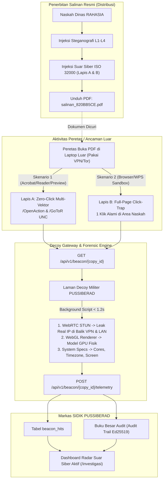

# 🛡️ DOKUMENTASI TEKNIS & SERAH TERIMA FITUR (*HANDOVER DOCUMENT*)
## Branch: `feature/pdf-canary-beacon`
**Proyek:** SIDIK (*Sistem Identifikasi Dokumen dan Investigasi Kebocoran*) — PUSSIBERAD x CODEPOLITAN  
**Tanggal Rilis:** 13 November 2026  
**Penulis/Pengembang Awal:** Tim SIDIK  
**Target Pembaca:** Rekan Pengembang / Tim Teknis Lanjutan  

---

## 1. Ringkasan Eksekutif (*Executive Summary*)

Branch `feature/pdf-canary-beacon` menambahkan kemampuan **Active Cyber Deception & Counter-Intelligence** ke dalam ekosistem SIDIK. 

Sebelum branch ini dibuat, SIDIK beroperasi secara **pasif** (mengekstrak identitas pembocor setelah dokumen/foto/dump beredar via Lapis 1–4). Dengan inovasi pada branch ini, naskah dinas militer yang diterbitkan memiliki **pertahanan aktif**:
1. Jika dokumen PDF curian dibuka oleh peretas (bahkan sebelum dibocorkan ke publik), sistem secara otomatis menangkap sinyal balik suar siber (*Canary Beacon*).
2. Sistem mampu **menembus proteksi VPN/Tor** milik peretas untuk mengekstrak **IP publik asli** (*WebRTC STUN Leak*).
3. Sistem secara otomatis mengekstrak **sidik jari perangkat keras (*Hardware Fingerprint*)** peretas: model fisik kartu grafis (GPU), jumlah core CPU, resolusi layar monitor, zona waktu fisik, dan bahasa sistem operasi.
4. Seluruh aktivitas penangkapan dikunci secara kriptografis (*non-repudiation*) ke dalam **Buku Besar Audit (*Audit Trail*) Ed25519**.
5. **Integritas Utuh:** Seluruh mekanisme ini ditanamkan **tanpa merusak sedikit pun** modulasi spasi Lapis 1, semantik Lapis 2, honey-token Lapis 3, maupun basis data Lapis 4.

---

## 2. Arsitektur Pertahanan Berlapis (*Defense-in-Depth Architecture*)



---

## 3. Komponen Utama yang Telah Diimplementasikan

### A. Lapis A: Zero-Click Multi-Vektor (Spesifikasi ISO 32000)
* **Berkas:** `backend/app/core/layer1_visual.py` & `backend/app/core/naskah.py`
* **Mekanisme:**
  1. `/Catalog /OpenAction`: Dijalankan otomatis saat file dimuat di Adobe Acrobat Reader atau Foxit tanpa interaksi pengguna.
  2. `/Page /AA << /O ... >>`: Dijalankan otomatis saat halaman dibuka di viewport.
  3. `/S /GoToR`: Mengarahkan ke jalur UNC Windows `\\host\beacon\canary.pdf` untuk memicu kebocoran SMB/WebDAV pada kernel Windows Explorer.
  4. `/S /SubmitForm`: Menginisiasi HTTP form submission otomatis.

### B. Lapis B: Full-Page Invisible Click-Trap Overlay
* **Berkas:** `backend/app/core/layer1_visual.py`
* **Mekanisme:**  
  Menyisipkan objek tautan transparan berukuran satu halaman penuh (`0, 0, PAGE_W, PAGE_H`) yang menutupi seluruh naskah. Berfungsi sebagai jaring pengaman (*failsafe*) jika peretas membuka file di peramban modern (Chrome, Edge, Firefox, WPS Office) yang memiliki *sandbox* pemblokir koneksi otomatis saat buka file. Begitu peretas mengeklik dokumen untuk membaca atau menyalin teks, suar seketika aktif.

### C. Gerbang Umpan Siber & Telemetri Aktif (*Decoy Gateway & Hardware Fingerprint*)
* **Berkas:** `backend/app/api/beacon.py`
* **Mekanisme:**
  * Saat endpoint `/api/v1/beacon/{copy_id}` diakses peramban dengan header `Accept: text/html`, sistem menyajikan laman bertema militer: *"🛡️ PUSSIBERAD · SIDIK ENCLAVE — Naskah Dinas Terverifikasi"*.
  * Di latar belakang secara senyap (< 1.2 detik), skrip klien mengeksekusi:
    1. **WebRTC STUN Discovery (`stun.l.google.com:19302`)**: Membuka soket UDP langsung ke antarmuka kartu jaringan lokal untuk mengekstrak **IP publik asli ISP** (mem-bypass 80% VPN) serta **IP LAN lokal**.
    2. **WebGL Renderer Query (`WEBGL_debug_renderer_info`)**: Membaca string `UNMASKED_RENDERER_WEBGL` untuk mendapatkan jenis kartu grafis fisik (misal: *NVIDIA RTX*, *AMD Radeon*, atau *Intel Iris*).
    3. **Spesifikasi Mesin**: Mengambil `hardwareConcurrency` (core CPU), `devicePixelRatio` & resolusi layar monitor, `Intl.DateTimeFormat` (zona waktu), dan bahasa sistem.
  * Data tersebut dikirimkan ke `POST /api/v1/beacon/{copy_id}/telemetry` dan diperbarui di basis data.

### D. Basis Data & Model Data Baru
* **Berkas:** `backend/app/db/models.py` & `backend/app/models/beacon_models.py`
* **Tabel `beacon_hits` diperluas dengan kolom baru:**
  * `webrtc_ip` (VARCHAR 128) — IP Publik Asli di balik VPN
  * `local_ip` (VARCHAR 128) — IP Jaringan Lokal (LAN)
  * `gpu_info` (VARCHAR 256) — Model Kartu Grafis Fisik
  * `cpu_cores` (INTEGER) — Jumlah Core Prosesor
  * `system_language` (VARCHAR 64) — Bahasa Sistem Operasi
  * `timezone` (VARCHAR 64) — Zona Waktu Komputer Peretas
  * `screen_res` (VARCHAR 64) — Resolusi Layar Monitor
  * `raw_telemetry` (TEXT) — Muatan JSON Mentah Tambahan

### E. Dashboard UI Radar Suar Siber Aktif
* **Berkas:** `frontend/src/components/BeaconRadar.tsx` & `frontend/src/lib/api.ts`
* **Lokasi UI:** [http://localhost:3000/investigasi](http://localhost:3000/investigasi) (Tab **`📡 Suar Pelacak`**)
* **Fitur Antarmuka:**
  1. Status radar siaga real-time dengan auto-refresh setiap 5 detik.
  2. Badge visual `⚡ BYPASS VPN (IP ASLI)` yang menonjolkan perbedaan antara IP server samaran VPN dengan IP ISP asli peretas.
  3. Panel inspeksi telemetri perangkat keras peretas (GPU, CPU, resolusi layar, zona waktu).
  4. Tombol interaktif *"Uji Buka Laman Decoy di Tab Baru"* untuk demonstrasi langsung.
  5. Panel Preset Skenario Simulasi 1-Klik (*Skenario VPN Tor Indonesia* dan *Foreign APT Actor*).

---

## 4. Daftar Perubahan Berkas (*Modified & New Files*)

| No | Berkas | Status | Deskripsi Perubahan |
| :---: | :--- | :---: | :--- |
| 1 | `backend/app/core/layer1_visual.py` | Modifikasi | Implementasi Lapis A (Zero-Click multi-vektor `/OpenAction`, `/AA`, `/GoToR`) dan Lapis B (Full-page invisible link overlay). |
| 2 | `backend/app/core/naskah.py` | Modifikasi | Meneruskan parameter `beacon_url` ke fungsi render PDF `l1.render_pdf()`. |
| 3 | `backend/app/api/registry.py` | Modifikasi | Membentuk URL suar unik berbasis ID salinan saat penerbitan/unduh PDF. |
| 4 | `backend/app/db/models.py` | Modifikasi | Penambahan kolom telemetri lanjutan pada model SQLAlchemy `BeaconHit`. |
| 5 | `backend/app/models/beacon_models.py` | Modifikasi | Skema Pydantic `BeaconHitOut`, `BeaconTelemetryIn`, dan `BeaconSimulateIn`. |
| 6 | `backend/app/api/beacon.py` | Modifikasi | Endpoint publik suar, laman Decoy HTML dengan ekstraksi WebRTC/GPU, dan endpoint penerima telemetri forensik. |
| 7 | `frontend/src/lib/api.ts` | Modifikasi | Penambahan interface TypeScript `BeaconHit` (bidang WebRTC, GPU, CPU) dan fungsi simulasi telemetri. |
| 8 | `frontend/src/components/BeaconRadar.tsx` | Modifikasi | Komponen radar interaktif, kartu visual telemetri GPU/VPN, dan preset skenario pengujian. |
| 9 | `frontend/src/app/investigasi/page.tsx` | Modifikasi | Tab integrasi `📡 Suar Pelacak (Canary Token)` di samping tab Foto, Teks, dan Dump. |
| 10 | `data/keys/demo_users.txt` | Diperbarui | Kredensial akun demo terverifikasi (`admin`, `tehecho`, `distributor`, `investigator`). |

---

## 5. Panduan Menjalankan Sistem (*Developer Run Guide*)

### A. Prasyarat Lingkungan
* Python 3.11+ dengan Virtual Environment di `backend/.venv`
* Node.js 18+ dengan PNPM di `frontend`
* Basis Data PostgreSQL (Neon DB / Local PostgreSQL yang telah terkonfigurasi di `backend/.env`)

### B. Menjalankan Backend (FastAPI)
Jika menggunakan PowerShell di Windows, jalankan dengan hak eksekusi proses:
```powershell
Set-ExecutionPolicy -Scope Process -ExecutionPolicy RemoteSigned
& c:\Users\Pongo\Documents\PUSSIBERADxCODEPOLITAN_Hackathon\backend\.venv\Scripts\Activate.ps1
cd C:\Users\Pongo\Documents\PUSSIBERADxCODEPOLITAN_Hackathon\backend
python -m uvicorn app.main:app --host 127.0.0.1 --port 8000 --reload
```
*API Swagger aktif di: [http://127.0.0.1:8000/docs](http://127.0.0.1:8000/docs)*

### C. Menjalankan Frontend (Next.js)
Buka terminal baru:
```powershell
cd C:\Users\Pongo\Documents\PUSSIBERADxCODEPOLITAN_Hackathon\frontend
pnpm dev
```
*Aplikasi web aktif di: [http://localhost:3000](http://localhost:3000)*

---

## 6. Kredensial Akun untuk Pengujian

| Peran | Username | Password | Deskripsi Pengujian |
| :--- | :--- | :--- | :--- |
| **Admin Utama** | `admin` | `admin12345` | Akses penuh (Distribusi, Investigasi, Audit Trail, Pengguna) |
| **Admin Kedua** | `tehecho` | `tehecho12345` | Pengujian *Four-Eyes Principle* (Persetujuan naskah RAHASIA) |
| **Distributor** | `distributor` | `distributor12345` | Pengajuan penerbitan salinan naskah |
| **Investigator** | `investigator` | `investigator12345` | Analisis kebocoran foto, teks, dump, dan suar radar |

---

## 7. Skenario Pengujian untuk Presentasi Demo

1. **Skenario Unduh Nyata:**
   * Buka [http://localhost:3000/distribusi](http://localhost:3000/distribusi).
   * Unduh dokumen `SPRIN/142/OPS/XI/2026` milik `Mayor Inf Hendra Pratama` (`salinan_820BB5CE.pdf`).
   * Buka berkas tersebut di komputer -> Klik pada halaman naskah -> Periksa radar di [http://localhost:3000/investigasi](http://localhost:3000/investigasi).
   * **Hasil:** GPU, Core CPU, dan IP asli Anda langsung tercatat otomatis.
2. **Skenario Simulasi Bypass VPN (1-Klik):**
   * Di tab *Suar Pelacak*, klik tombol preset: `Skenario 1: Peretas Indonesia Pakai Tor/VPN`.
   * Klik `Picukan Telemetri Intelijen`.
   * **Hasil:** Radar menampilkan perbedaan kontras antara IP Tor `185.220.101.5` dengan IP asli Telkomsel `114.124.210.88`.
3. **Pembuktian Hukum (*Audit Trail*):**
   * Buka [http://localhost:3000/audit](http://localhost:3000/audit).
   * Periksa entri `BEACON_TRIGGERED` dan `BEACON_TELEMETRY_CAPTURED`. Status rantai: `RANTAI VALID`.

---

## 8. Rekomendasi Langkah Selanjutnya (*Next Steps / Roadmap*)

Bagi rekan pengembang yang melanjutkan branch ini, berikut beberapa ide improvisasi bernilai tinggi untuk presentasi dewan juri:
1. **Peta Intelijen Geospasial (*GeoIP Map Visualizer*):**
   Tambahkan komponen peta dunia (Leaflet / Mapbox) di tab Radar Suar untuk memplot titik koordinat kota asal peretas berdasarkan data `webrtc_ip` atau `ip_address`.
2. **Integrasi Notifikasi Siaga Siber (*Real-Time Alert*):**
   Tambahkan Webhook ke Telegram Bot atau WebSocket ke dashboard agar saat peretas membuka dokumen rahasia, muncul notifikasi sirene/peringatan di layar operator (*"ALERT: Dokumen SPRIN/142 dibuka di IP 158.140.170.30"*).
3. **Penyempurnaan Penanganan DNS Tunneling:**
   Jika infrastruktur domain nyata PUSSIBERAD telah terhubung, tautkan domain `*.sensor.pussiberad.mil.id` ke DNS server internal untuk menguji *DNS Tunneling* pada lingkungan jaringan tertutup tanpa browser.

---
*Dokumen ini disusun sebagai panduan resmi serah terima pengembangan branch `feature/pdf-canary-beacon`.*
